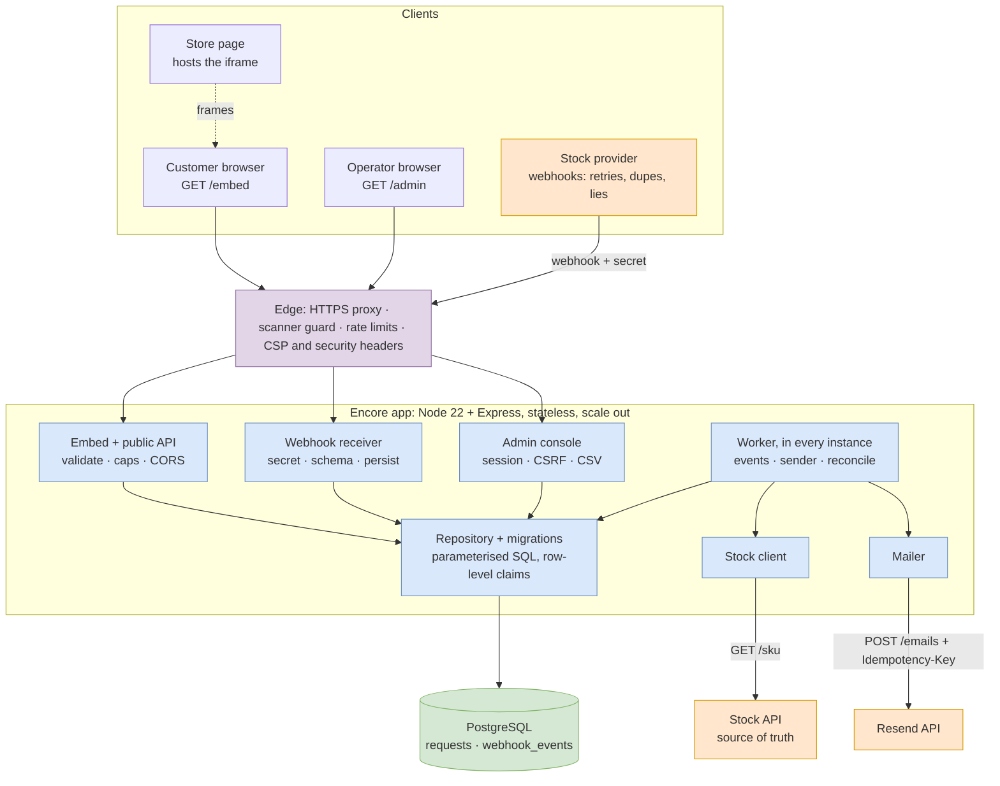
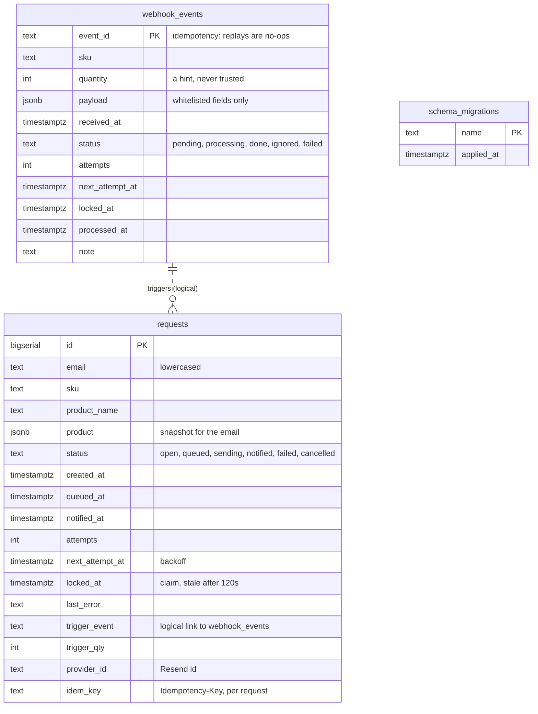
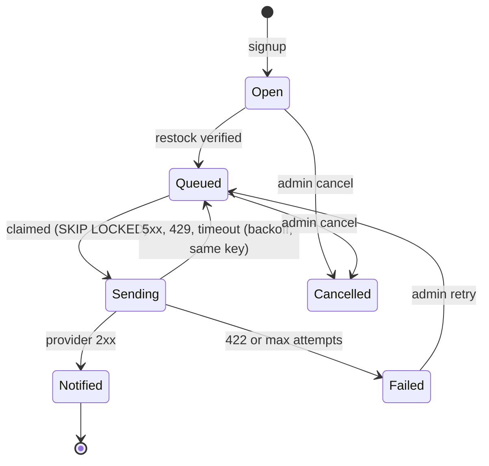
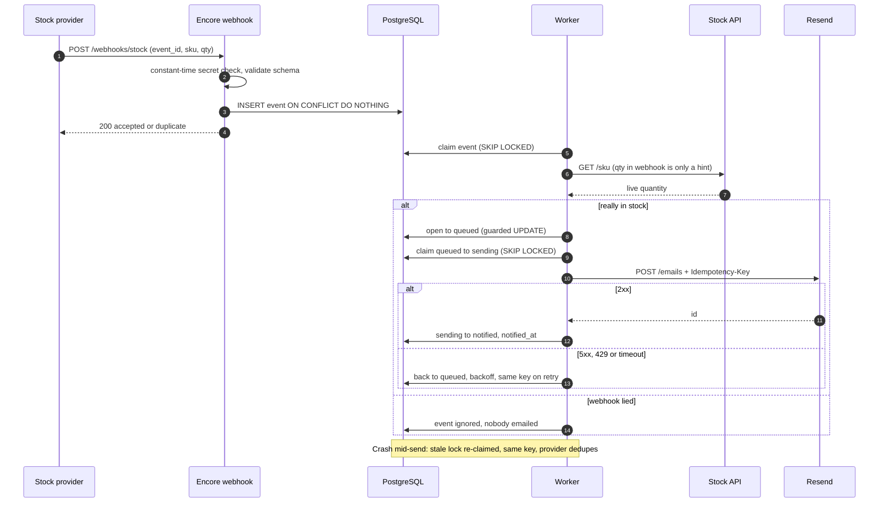
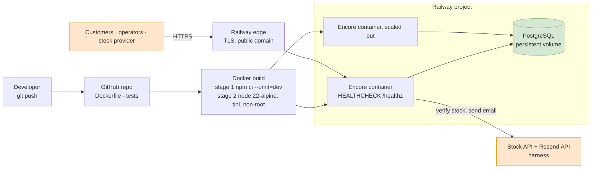

# Architecture diagrams

These render natively on GitHub. Editable draw.io versions of the same diagrams were produced alongside (system architecture, database design, state machine, sequence, deployment).

## 1. System architecture

## 2. Database design

Constraints and indexes that carry the guarantees:

| Guarantee | Mechanism |
|---|---|
| No duplicate open requests | `UNIQUE (email, sku) WHERE status IN ('open','queued','sending')` |
| Replayed webhooks are no-ops | `webhook_events.event_id` primary key, `ON CONFLICT DO NOTHING` |
| Exactly one worker owns a row | `UPDATE … WHERE id IN (SELECT … FOR UPDATE SKIP LOCKED)` plus status guards |
| Fast "who is waiting for SKU" | `INDEX (sku, status)` |
| Cheap queue scans | partial indexes on `next_attempt_at` (queued, pending) and `locked_at` (sending) |
| Safe concurrent boot | migrations run under `pg_advisory_lock` |

## 3. Request lifecycle

A `Sending` row whose lock is older than 120 s belongs to a crashed worker: it is claimed again and sent with the same `Idempotency-Key`, so the provider cannot deliver twice.

## 4. Exactly-once delivery

## 5. Build and deployment

Local alternative: `docker compose up --build` runs the same image next to `postgres:16-alpine` with a health-gated start order.
